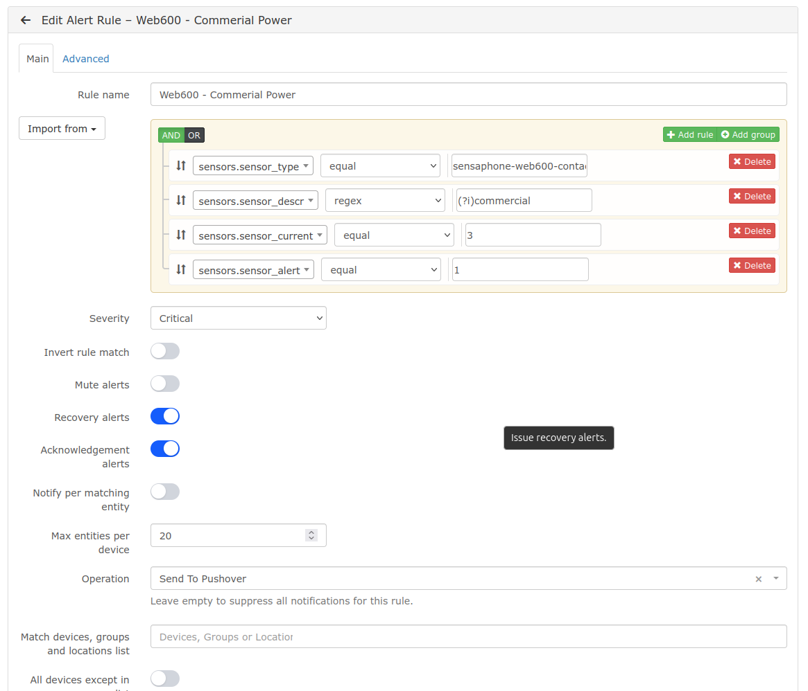
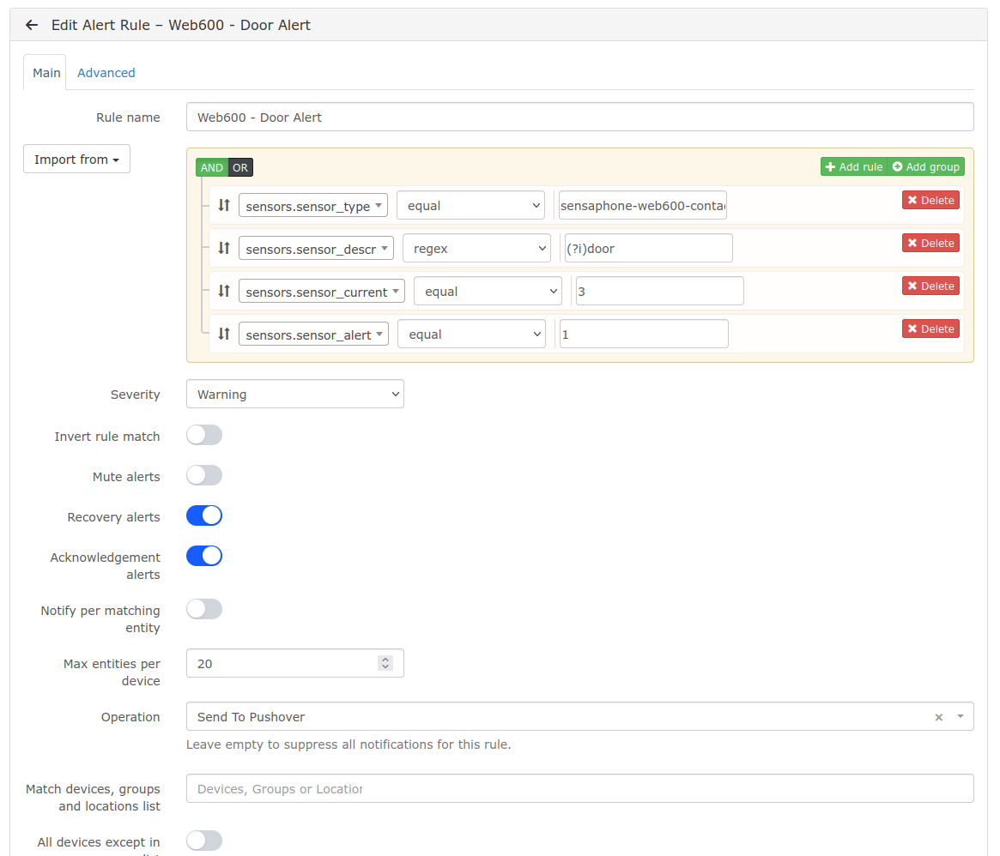
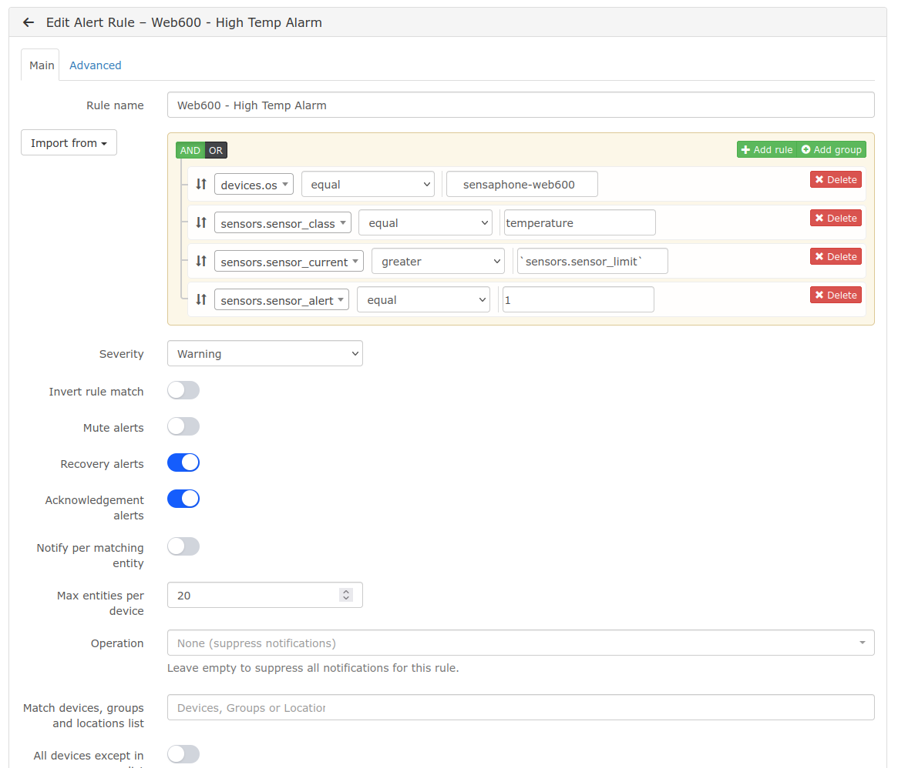

# Sensaphone WEB600 support for LibreNMS

Adds SNMP discovery and monitoring for the Sensaphone WEB600. LibreNMS can show alarm status for enabled inputs and temperature readings for supported temperature probes.

## Requirements

- An existing LibreNMS installation with PHP 8.3 or later. The installer expects the root directory to contain `lnms`.
- A WEB600 with SNMP enabled and reachable from the LibreNMS poller.
- Write access to the LibreNMS installation directory. If you copy the files from Windows, use a mapped drive or network share that exposes that directory.

## Install on the LibreNMS host

Clone the repository and run the installer. It defaults to `/opt/librenms`.

```bash
git clone https://github.com/daryl-peterson/librenms-sensaphone-web600.git
cd librenms-sensaphone-web600
./install.sh
```

For a custom installation path, pass it as an argument.

```bash
./install.sh "/path/to/librenms"
```

Run as the account that owns the LibreNMS files, or use `sudo ./install.sh` if your account needs permission to write there. The script checks the PHP file and matches each destination file’s ownership to a neighboring LibreNMS file.

## Copy from Windows

In Command Prompt, open the cloned or extracted repository and run `install.bat` with the LibreNMS root. For example, use a mapped drive or a UNC path.

```bat
install.bat "Z:\LibreNMS"
install.bat "\\monitoring-server\librenms"
```

Use a share account that can write to the LibreNMS tree. Confirm on the LibreNMS host that its service account can read the copied files. Run device discovery and polling on that host.

Both installers skip identical files and stop if a destination file differs. Review any conflicting file before replacing it.

## Add or rediscover the WEB600

For a new device, open **Devices → Add Device** in LibreNMS and enter the WEB600 hostname or IP address and its SNMP settings. For command-line options, see the [LibreNMS guide to adding a device](https://docs.librenms.org/Support/Adding-a-Device/).

From the LibreNMS directory, run these commands as the LibreNMS service account. Replace `web600.example.local` with the hostname or IP address used when adding the device.

```bash
./lnms device:discover web600.example.local
./lnms device:poll web600.example.local
```

Open the device in LibreNMS and check that it identifies as **Sensaphone WEB600** and shows the available sensors under **Health**. If detection fails, verify that the poller can reach the device over SNMP and that the device reports `.1.3.6.1.4.1.8338.1.1.4` as its `sysObjectID`. See the [discovery guide](https://docs.librenms.org/Support/Discovery%20Support/) and [poller guide](https://docs.librenms.org/Support/Poller%20Support/).

## Create WEB600 alert rules

Run discovery and polling first, then open the WEB600's **Health** tab and confirm the inputs you want to monitor are listed. For the contact rules, check the displayed sensor descriptions. The examples look for inputs whose names contain `commercial` or `door`.

1. In LibreNMS, open **Alerts → Alert Rules** and create a rule.
2. In the **Main** tab, enter the rule name and leave the condition group set to **AND**. Use **Add rule** to add each row from the matching table below.
3. Set the severity and operation shown for that rule. The screenshots have **Recovery alerts** and **Acknowledgement alerts** enabled and **Invert rule match**, **Mute alerts**, and **Notify per matching entity** disabled.
4. To limit a rule to one WEB600, select it in **Match devices, groups and locations list** and leave **All devices except in list** off. Save the rule and check its status after the next poll and alert cycle.

**Send To Pushover** is the name of the notification operation used in the contact-rule screenshots. To reproduce it, configure a Pushover transport, add that transport to an alert operation, then select the operation on the rule. You can also select an operation you already use. With **None (suppress notifications)**, the rule still raises alerts in LibreNMS. [Alert rules](https://docs.librenms.org/Alerting/Rules/) · [Alert operations](https://docs.librenms.org/Alerting/Operations/) · [Pushover setup](https://docs.librenms.org/Alerting/Transports/Pushover/)

### Commercial power

Use the rule name **Web600 - Commercial Power**, severity **Critical**, and operation **Send To Pushover**.

| Field                    | Operator | Value                       |
| ------------------------ | -------- | --------------------------- |
| `sensors.sensor_type`    | equal    | `sensaphone-web600-contact` |
| `sensors.sensor_descr`   | regex    | `(?i)commercial`            |
| `sensors.sensor_current` | equal    | `3`                         |
| `sensors.sensor_alert`   | equal    | `1`                         |



### Door alert

Use the rule name **Web600 - Door Alert**, severity **Warning**, and operation **Send To Pushover**.

| Field                    | Operator | Value                       |
| ------------------------ | -------- | --------------------------- |
| `sensors.sensor_type`    | equal    | `sensaphone-web600-contact` |
| `sensors.sensor_descr`   | regex    | `(?i)door`                  |
| `sensors.sensor_current` | equal    | `3`                         |
| `sensors.sensor_alert`   | equal    | `1`                         |

Both contact rules match the WEB600's **Open Alarm** state (`3`). If your input reports **Closed Alarm** instead when it alarms, use `2`. The `(?i)` prefix makes the name match case-insensitive. Adjust the pattern if the sensor is named differently.



### High temperature

Use the rule name **Web600 - High Temp Alarm**, severity **Warning**, and operation **None (suppress notifications)** to match the screenshot. Select a notification operation if you want an external notification.

| Field                    | Operator | Value                        |
| ------------------------ | -------- | ---------------------------- |
| `devices.os`             | equal    | `sensaphone-web600`          |
| `sensors.sensor_class`   | equal    | `temperature`                |
| `sensors.sensor_current` | greater  | `` `sensors.sensor_limit` `` |
| `sensors.sensor_alert`   | equal    | `1`                          |

Include the backticks around `sensors.sensor_limit` in the value field so LibreNMS compares against the sensor's stored upper limit. Verify or set that limit under the device's **Settings → Health**. WEB600 temperature readings are stored in Celsius. [LibreNMS sensor limits](https://docs.librenms.org/Support/Device-Sensors/)




## Files copied

The paths below are relative to the LibreNMS root.

- `resources/definitions/os_detection/sensaphone-web600.yaml`
- `LibreNMS/OS/SensaphoneWeb600.php`
- `html/images/os/sensaphone-web600.svg`
